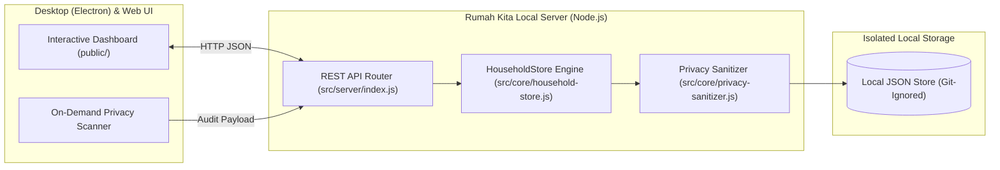

<div align="center">

# 🏠 Rumah Kita

**Privacy-First Open-Source Smart Home, Household Finance & Community (RT/RW) Management Platform**

[](LICENSE)
[](https://github.com/NopeKagennnou/rumah-kita/actions)
[](package.json)
[](SECURITY.md)
[](CONTRIBUTING.md)

*Built for families, smart-home enthusiasts, and neighborhood communities (RT/RW) who want complete visibility over household finances, IoT energy consumption, logistics inventory, and shared tasks — without sacrificing personal privacy or leaking device data to the cloud.*

</div>

---

## ✨ Key Features

1. **💰 Household & Community (RT/RW) Finance Ledger**
   - Track income, utility bills, groceries, maintenance, and neighborhood dues (`Iuran Kas RT/RW`).
   - Real-time calculation of net balance and household savings rate.
   - One-click **Sanitized JSON Export** that automatically strips any personal device paths or credentials.

2. **⚡ Smart Home & IoT Energy Management**
   - Monitor and toggle smart devices across rooms (Lighting, Climate/AC, Security CCTV, Appliances, Solar/Pumps).
   - Real-time active load computation (`Watts`), monthly consumption projection (`kWh/month`), and estimated electricity tariff calculation (`IDR`).

3. **📦 Pantry & Logistics Inventory Tracker**
   - Track essential household supplies (`Beras`, `Air Galon`, `LPG`, `Kotak P3K`, etc.) with automated low-stock threshold alerts.

4. **🤝 Family & Neighborhood Task Coordination**
   - Organize maintenance schedules, community workdays (`Kerja Bakti`), and household responsibilities with priority tags.

5. **🛡️ Built-In Privacy Guard & Anti-Leak Engine**
   - Dedicated `privacy-sanitizer.js` module and `privacy-guard.js` CLI scanner ensure that **zero local device paths** (such as Windows `AppData` paths or Unix `$HOME` directories), API keys (`sk-...`, `sk-ant-...`), GitHub tokens, or MAC addresses ever leak into logs, exports, or Git commits.

---

## 🏗️ Architecture Overview



---

## 🚀 Quick Start

### Prerequisites
- **Node.js** `>= 18.0.0` (Zero external npm dependencies required to run the core server and test suite!)

### 1. Clone & Run Instantly
```bash
git clone https://github.com/NopeKagennnou/rumah-kita.git
cd rumah-kita

# Start the Rumah Kita Server (defaults to http://127.0.0.1:3080)
npm start
```

### 2. Run via CLI
```bash
node ./bin/rumah-kita.js status
node ./bin/rumah-kita.js serve --port 3080
```

### 3. Run Desktop Mode (Electron)
If you have Electron installed globally or in your environment:
```bash
npm run electron
```
*(If Electron is not installed, `npm run electron` automatically falls back to the local Web Server mode so it never crashes).*

---

## 🔒 Syncing from a Local Windows Installation (Zero Data Leak)

If you have an existing local installation on Windows (for example under `%LOCALAPPDATA%\Programs\Rumah Kita`), this repository includes an automated, privacy-hardened PowerShell script that syncs source updates while **strictly blocking** `.exe`/`.dll` binaries, local databases, `.env` secrets, and hardcoded `C:\Users\<username>` paths:

```powershell
powershell -ExecutionPolicy Bypass -File scripts/sync-from-local-windows.ps1
```

---

## 🧪 Testing & Security Verification

Rumah Kita ships with a built-in zero-dependency test suite and privacy audit pipeline:

```bash
# Run unit & integration tests (Finance, Energy, Inventory, REST API, Privacy Guard)
npm test

# Run syntax check, Open-Source governance check, and anti-leak scan
npm run lint

# Run standalone Privacy Guard repository scan
npm run security:scan
```

---

## 🤝 Contributing & Governance

We welcome community contributions, bug reports, and feature requests!
- Please read our [Contributing Guide](CONTRIBUTING.md) before submitting a Pull Request.
- Please review our [Code of Conduct](CODE_OF_CONDUCT.md) and [Security & Privacy Policy](SECURITY.md).

---

## 📄 License

Distributed under the OSI-approved **MIT License**. See [`LICENSE`](LICENSE) for full license text.
